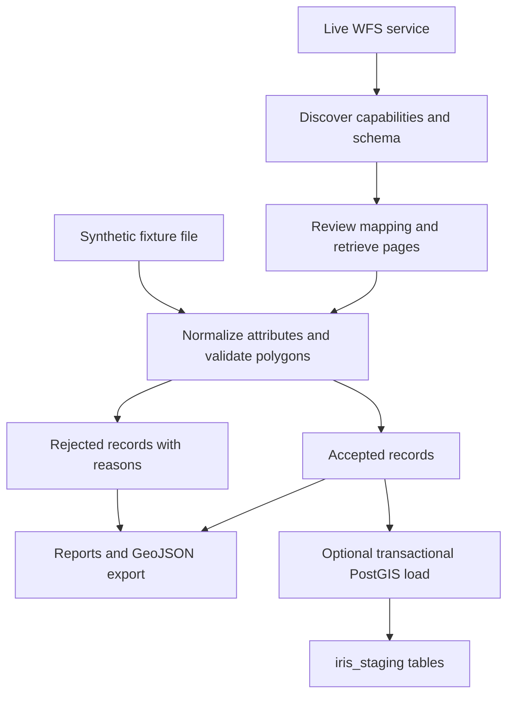

# Understanding the project

This is a backend data ingestion project for IRIS. It takes geographic records
about compensation parcels, checks their attributes and boundaries, and stores
accepted records in a reviewable staging database. It also records what it
rejected, repaired, or could not verify.

The current demonstration uses synthetic parcels because the assignment's WFS
endpoint returned HTTP 404 when checked on 2026-10-27. No real registered sites
were downloaded. The live client is implemented, but its compatibility with the
actual provider still requires access and schema review.

**Update 2026-10-28:** a separately labelled real-data adapter now processes the
public LISt compensation-measure GeoPackage. The original fixture/WFS walkthrough
below still applies to that path; [ALTERNATIVE_SOURCE.md](ALTERNATIVE_SOURCE.md)
explains the additional input, actual attributes, distinct domain and licence.

## 1. The problem the assignment asks us to solve

The source is supposed to publish parcels associated with ecological compensation
or eco-account measures in Saxony. Each parcel can have a boundary and descriptive
attributes: an identifier, municipality, cadastral district, status, area, and
possibly ecological credits.

External datasets can have missing attributes, inconsistent text, invalid
boundaries, changing schemas, and unreliable downloads. Loading everything directly
would make later analysis unreliable. This project puts explicit checks between
the source and the database, while retaining evidence of what the source supplied.

The intended destination is `iris_staging.compensation_sites`. A PostgreSQL schema
is a namespace for tables; `iris_staging` is the namespace and
`compensation_sites` is the table. Staging allows review before any later system
chooses to use the data. This program has no step that promotes records into
`iris_core`.

## 2. The overall flow

The two input paths join at the same normalization function. That means fixture
tests exercise the transformation and database code that the live path would use.
Mocked HTTP tests separately exercise discovery and pagination. Fixtures alone
cannot prove that the real service uses the supported protocol and schema.

## 3. Discovering and downloading from WFS

WFS means Web Feature Service: a standardized interface for geographic objects.
A feature combines a shape, called its geometry, with descriptive properties.

The client in `iris_oek/wfs.py` first requests `GetCapabilities`. It looks for
exactly one advertised feature type whose local name is
`sn_oekokonto_flurstuecke`. It resolves that feature type's namespace, reads its
default coordinate reference system, and checks the advertised formats, paging,
and sorting support.

Next, `DescribeFeatureType` supplies the attribute schema as XSD, an XML schema
document. The client extracts the declared fields and saves a SHA-256 fingerprint
of the document. Live ingestion requires that fingerprint in the reviewed
configuration. A changed schema therefore requires another review.

Field meanings still need human verification. An XSD can declare a decimal field
without proving whether it means hectares, square metres, or ecological points.
The program uses only explicitly configured meanings and units.

For retrieval, the client requests a numeric record count using
`GetFeature&resultType=hits`. It then requests pages sorted by a reviewed unique
identifier. `count` controls the requested page size; `startIndex` controls the
offset. The next offset advances by the number actually returned, which handles
servers that return fewer records than requested.

The count is checked again at the end. Repeated identifiers, unexpectedly empty
pages, changed counts, incorrect CRS declarations, and page-limit exhaustion
abort acquisition before any site is loaded. Before/after counts help detect
changes but cannot detect every concurrent edit with an unchanged total.

Default controls include 100 records per page, one-second request spacing,
30-second socket timeouts, a 20 MB response limit, and at most two retries.
Temporary transport/server failures can be retried. Access-denied responses are
reported without retrying around the restriction. Redirects are refused.

Response bodies are archived alongside request parameters, timestamps, HTTP
statuses, and hashes. These records help explain exactly which input produced an
output. The client currently supports WFS 2.0, JSON features with an explicit CRS,
and a simple named XSD feature type; unsupported service arrangements stop with
an error.

## 4. Normalizing attributes

`iris_oek/config.py` defines the configuration, and `normalize.py` transforms each
feature into an internal `Record`. A mapping connects a source field name to its
target meaning. For example, the synthetic fixture maps `gemeinde` to
`municipality`. This is a test mapping, not a verified real Saxony attribute name.

Names are normalized to Unicode NFC and repeated whitespace is collapsed.
Spelling and case are preserved. For example, `"  Dresden\t Stadt  "` becomes
`"Dresden Stadt"`.

Statuses use an explicit lookup table. An unknown status leaves the normalized
status null, retains the source text, and adds an `unmapped_status` flag. Missing
optional names, statuses, areas, and credits are reported rather than invented.

Numbers must satisfy the configured strict parser. A comma or dot decimal
separator is supported; ambiguous separators, negative values, and nonfinite
numbers are rejected. A mapped source area needs a verified unit: square metres
are retained, and hectares are multiplied by 10,000. Ecological credits need an
explicit unit and are never estimated from parcel area or status.

The state code is `SN`. When a source state field is mapped, its value must match
an explicitly allowed Saxony code. An approximate geographic envelope also catches
gross location errors. This envelope is not a substitute for an authoritative
state boundary or confirmation that the source contains the intended domain.

## 5. Validating the parcel boundaries

Shapely handles geometry checks and repair. GeoPandas and PyProj handle coordinate
transformations. Accepted source geometries must be nonempty 2D polygons or
multipolygons with finite coordinates.

A polygon describes a bounded area and can include holes. A multipolygon stores
several polygon parts in one feature. Both can represent a parcel record; points
and lines do not supply the required parcel area.

If a polygon is invalid, `make_valid(method='linework')` attempts repair. A
self-crossing polygon can become separate valid polygon parts. The result is
accepted only if it remains wholly polygonal and valid. A shape that collapses to
lines or produces mixed polygon/line components is rejected. The program records
the repair reason and retains the original geometry.

The working geometry is projected into **EPSG:25832**, as required by the
assignment, and represented as a valid MultiPolygon. A coordinate reference system
defines how coordinate numbers correspond to locations. In this projected CRS,
coordinates use metres, allowing planar area measurements in square metres.

Two area values stay separate:

- `area_m2`: area calculated from the final projected working geometry.
- `source_area_m2`: optional area supplied by the provider, converted using a
  verified source unit.

A difference above 5% is flagged. The source value is not silently replaced.
Original coordinates are retained as JSON, with the original CRS string and WKT,
a full text description of that CRS. The synthetic source uses EPSG:25833, while
the working database geometry uses EPSG:25832. The GeoJSON export uses WGS84
longitude/latitude for common map tools.

## 6. Identifying sites and handling repeated runs

Every site needs an identity that stays stable when its attributes change. The
program constructs `site_id` from the fixture/live scope, namespace, layer, and
source identifier using SHA-256. The database primary key is
`(site_id, state_code)`.

The identity does not depend on row order, current status, municipality spelling,
or geometry. Changing an attribute can therefore update the existing site. A
separate `content_hash` detects changes in the normalized content and retained
source data.

Fixture and live identities have separate scopes, so the sample data cannot
accidentally replace a real site with the same source ID. The database also stores
`is_fixture` so queries can explicitly exclude demonstration records.

An upsert inserts a new key or updates an existing one:

| Input compared with the database | Behavior |
|---|---|
| New stable key | Insert one row |
| Existing key, changed content | Update the existing row |
| Existing key, identical content | Refresh last-seen/run metadata; leave content and `updated_at` unchanged |

Identical duplicates within offline input are counted once. Conflicting duplicate
IDs abort processing because choosing one would be arbitrary. Repeated IDs across
live pages abort acquisition because they can indicate broken paging or an unstable
source.

## 7. Loading safely into PostGIS

PostGIS extends PostgreSQL with geometry storage, spatial indexes, and geographic
queries. `iris_oek/load.py` performs the load using parameterized values and
explicit `iris_staging` table names.

The database checks geometry type, SRID, validity, required source identity, state,
and numeric constraints. A spatial index supports queries such as finding parcels
that intersect a search area.

Site upserts and successful run/issue audit records share one transaction. If a
statement fails, PostgreSQL rolls back the entire transaction. For example, a
failure on the second insert removes the first insert from that attempted load.
An advisory lock serializes runs of this harvester against the same database.

There are three staging tables:

| Table | Purpose |
|---|---|
| `compensation_sites` | Accepted site records and provenance |
| `harvest_runs` | Successful committed run summaries |
| `harvest_issues` | Rejections, duplicate notices, and accepted-record quality flags |

Missing sites are not automatically deleted. An absent or rejected record does
not establish that the underlying site has ceased to exist. Last-seen metadata
supports later review of stale records.

The Compose setup separates initialization from runtime loading. A migration role
installs the schema and grants permissions; the loader role receives the required
staging permissions. The demo database publishes no host ports. Database credentials
are generated locally and excluded from version control.

## 8. Reports and failures

`iris_oek/cli.py` coordinates the process. `discover` inspects the source, `run`
validates and exports records, and `run --load` also commits accepted records.
`init-db` is a separate optional migration command for an isolated database with
PostGIS already installed.

Each invocation receives a UUID and writes an output directory. Successful
normalization produces a `report.json`, detailed `issues.json`, and a
`sites.geojson` export. Input copies or response archives support reproducibility.

A record-level rejection, such as a missing polygon, can be reported while other
valid records continue. A fatal acquisition failure, conflicting identity, or SQL
failure stops the run and returns a nonzero exit code. Database failures are
reported locally because an audit row in the failed transaction would roll back.

PostgreSQL and local files cannot commit atomically together. If an output failure
occurs after a database commit, the database run log is the authoritative evidence
of that committed load.

## 9. What was demonstrated

The fixture contains deliberately good and bad records:

| Processing outcome | Count |
|---|---:|
| Received | 12 |
| Accepted unique records | 4 |
| Rejected | 7 |
| Identical duplicate | 1 |
| Repaired among accepted records | 1 |

The repaired count is part of the four accepted records. Rejections cover missing
IDs, points, a contradictory state, an implausible location, null geometry,
collapsed polygons, and mixed-dimensional repair results.

The first fresh-database run inserted four rows. The second inserted zero and
reported four unchanged rows. Spatial validation found zero invalid geometries,
no duplicate keys, and only SRID 25832 for working geometries.

The recorded test run passed **35 tests**, including five integration tests against
a real isolated PostGIS service. HTTP mocks check WFS discovery, paging, retries,
and failures; normalization tests check attributes and shapes; database tests check
idempotence, updates, rollback, provenance, and restricted permissions.

## 10. Where to read the implementation

| File | Responsibility |
|---|---|
| `iris_oek/cli.py` | Commands, orchestration, output files, exit status |
| `iris_oek/config.py` | Explicit mappings and request limits |
| `iris_oek/wfs.py` | Discovery, HTTP requests, archives, pagination checks |
| `iris_oek/normalize.py` | Attribute parsing, geometry checks, stable IDs, outcome counts |
| `iris_oek/load.py` | Transactions, upserts, database audit logs |
| `iris_oek/sql/schema.sql` | Staging tables, constraints, spatial index |
| `sql/validate.sql` | Reproducible quality and spatial queries |
| `Dockerfile`, `docker-compose.yml` | Reproducible runtime and isolated PostGIS environment |
| `tests/` | Synthetic fixtures, HTTP mocks, automated checks |

Use [README.md](README.md) for commands, [MAPPING.md](MAPPING.md) for the exact
mapping and supported-source contract, and [QUALITY_REPORT.md](QUALITY_REPORT.md)
for observed results and remaining acceptance limits. Restored source access,
verified permissions, actual attribute meanings, and real registered-site
membership remain necessary before claiming a verified live integration.
